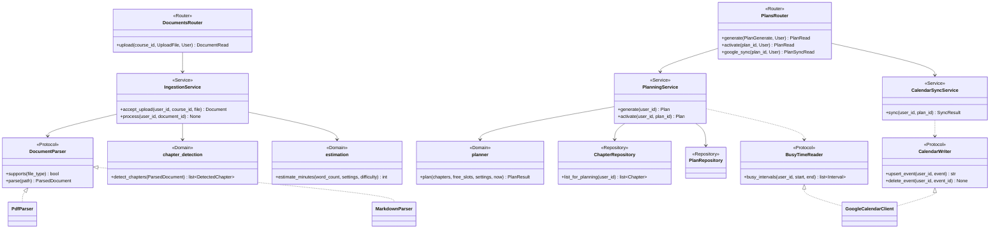
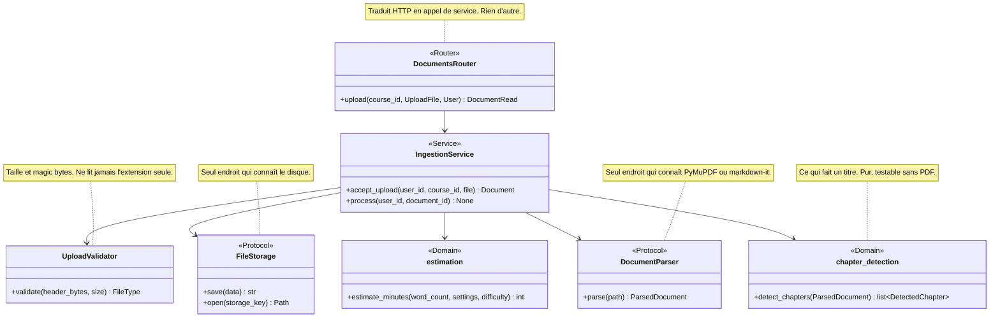
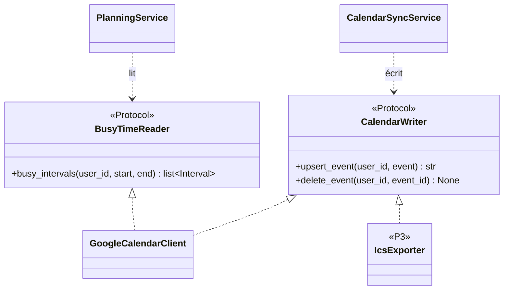
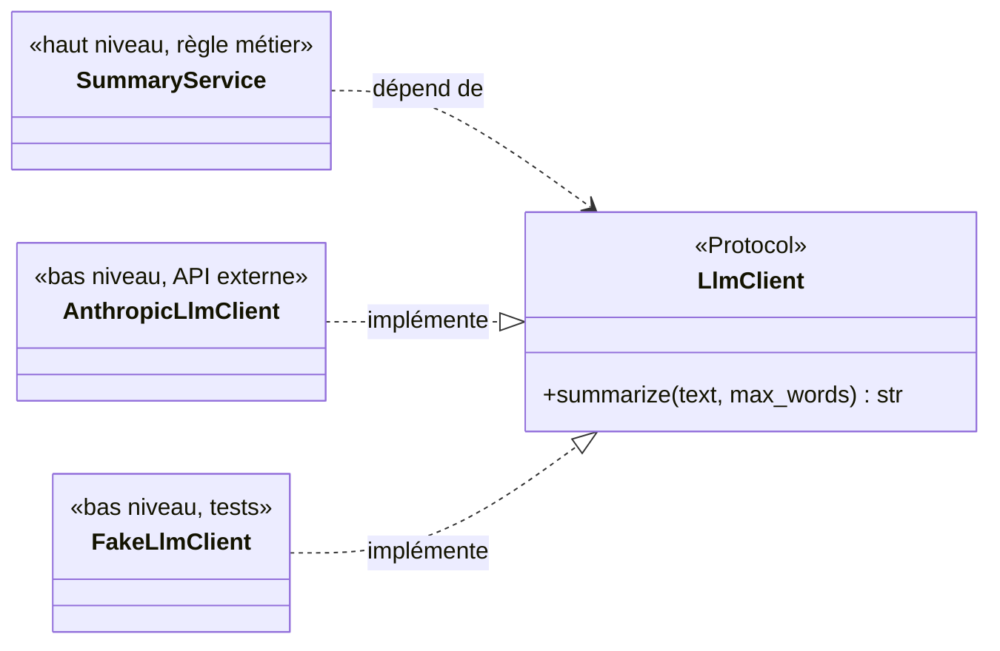
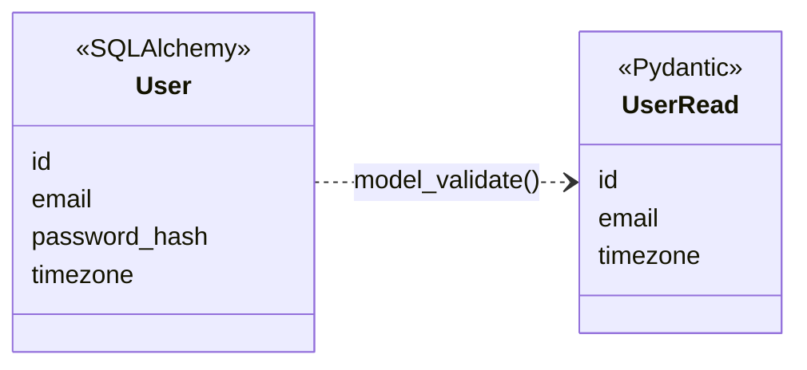

# Diagrammes de classes : SOLID appliqué

Le [README](../README.md) décrit *où* va le code (six couches). Ce document décrit *pourquoi les classes ont la forme qu'elles ont* : quel principe chaque découpage sert, et ce qu'il coûterait de ne pas le respecter.

**Le code n'existe pas encore.** Les classes ci-dessous sont celles que l'équipe s'engage à écrire ; leurs noms suivent les [conventions de nommage](conventions_de_nommage.md). Quand le code s'en écartera, c'est ce document qui sera corrigé, dans la même pull request, avec la raison de l'écart.

---

## 1. Vue d'ensemble



Les flèches importantes sont celles qui **manquent** :

- aucun router ne pointe vers un repository : un router traduit HTTP en appel de service, rien d'autre ;
- aucune classe du domaine (`planner`, `estimation`, `chapter_detection`) ne pointe vers quoi que ce soit d'autre que le domaine ;
- aucun service ne pointe vers `GoogleCalendarClient` ni vers `PdfParser` : ils ne connaissent que les interfaces.

Les sections suivantes expliquent pourquoi.

---

## 2. SRP : responsabilité unique

**Le principe** : une classe change pour une seule raison.

### La tentation

Le premier code qu'on écrit pour l'ingestion ressemble à ceci, parce que c'est l'ordre dans lequel on pense le problème :

```python
# À NE PAS ÉCRIRE
@router.post("/courses/{course_id}/documents")
async def upload(course_id: int, file: UploadFile, db: Session = Depends(get_db)):
    content = await file.read()                                   # lecture
    if not content.startswith(b"%PDF"):                           # validation
        raise HTTPException(415)
    path = f"storage/{file.filename}"                             # stockage
    open(path, "wb").write(content)
    doc = fitz.open(path)                                         # parsing PDF
    chapters = [t for (lvl, t, page) in doc.get_toc() if lvl == 1]  # détection
    for title in chapters:
        minutes = len(title.split()) / 200 * 1.2                  # estimation
        db.execute(f"INSERT INTO chapters (title) VALUES ('{title}')")  # persistance
    return {"ok": True}
```

Cette fonction change si : le format accepté change, le dossier de stockage change, PyMuPDF change d'API, la détection des chapitres s'améliore, la formule d'estimation change, le schéma de la table change. **Six raisons de changer pour une seule fonction**, et trois failles au passage : le nom du fichier vient de l'utilisateur (path traversal), le titre est injecté dans du SQL, et la propriété de `course_id` n'est jamais vérifiée.

### Le découpage retenu



La séparation la plus utile est entre `DocumentParser` et `chapter_detection`. Le parser transforme un fichier en `ParsedDocument` : une liste de blocs de texte avec leur niveau de titre, leur page, leur taille de police, et la table des matières si le PDF en a une. La détection décide ensuite ce qui est un chapitre, **sans ouvrir de fichier**.

C'est la partie qui se trompera (P0-06 le prévoit) et qui sera reprise le plus souvent. Elle se teste avec un `ParsedDocument` écrit à la main en trois lignes, au lieu de fabriquer un PDF pour chaque cas.

---

## 3. OCP : ouvert à l'extension, fermé à la modification

**Le principe** : ajouter un comportement ne doit pas modifier le code existant.

### Là où le changement est déjà annoncé

Les specs annoncent trois extensions. Chacune a son point d'extension dès la première version :

| Point d'extension | Aujourd'hui | Annoncé |
|---|---|---|
| `DocumentParser` | `PdfParser`, `MarkdownParser` (P0-04) | `DocxParser`, `PptxParser`, OCR (P3) |
| `NotificationChannel` | `EmailChannel` (P2-02) | Telegram, push (P2-02, P3) |
| `CalendarWriter` | `GoogleCalendarClient` (P1-01) | Outlook, iCal (P3) |

### La forme : un registre, pas un `if/elif`

```python
# À NE PAS ÉCRIRE
def parse(path: Path, file_type: FileType) -> ParsedDocument:
    if file_type is FileType.PDF:
        ...  # 40 lignes de PyMuPDF
    elif file_type is FileType.MARKDOWN:
        ...  # 30 lignes de markdown-it
```

Ajouter `.docx` obligerait à rouvrir cette fonction, déjà testée, et à risquer de casser les deux formats existants.

```python
class DocumentParser(Protocol):
    def supports(self, file_type: FileType) -> bool: ...
    def parse(self, path: Path) -> ParsedDocument: ...


class ParserRegistry:
    def __init__(self, parsers: Sequence[DocumentParser]) -> None:
        self._parsers = parsers

    def for_type(self, file_type: FileType) -> DocumentParser:
        for parser in self._parsers:
            if parser.supports(file_type):
                return parser
        raise UnsupportedFileTypeError(file_type)
```

La liste des parsers est construite à un seul endroit, `backend/core/container.py` :

```python
parser_registry = ParserRegistry([PdfParser(), MarkdownParser()])
```

**Ajouter `.docx` demande alors un fichier neuf et une ligne dans `container.py`.** `IngestionService` n'est jamais rouvert. Il faut aussi ajouter le type à la liste blanche de `UploadValidator` : c'est voulu, accepter un nouveau format doit rester une décision visible en revue, pas un effet de bord de l'ajout d'un parser.

### Là où OCP n'est pas appliqué

Le planificateur n'a **pas** de stratégie interchangeable (`GreedyPlanner`, `OptimalPlanner`…). Il n'y en a qu'une prévue, et rien dans les specs n'en annonce une deuxième. Une interface sans deuxième implémentation est un coût sans bénéfice : on l'introduira le jour où une autre stratégie sera réellement écrite.

---

## 4. LSP : substitution de Liskov

**Le principe** : toute implémentation doit pouvoir remplacer son interface sans que l'appelant le remarque.

`IngestionService` ne connaît que `DocumentParser`. Il ne doit jamais y avoir de `if isinstance(parser, PdfParser)` : ce serait le signe que le contrat est incomplet. Le contrat comprend des règles que la signature ne dit pas, et c'est là que LSP se joue.

### Contrat de `DocumentParser`

| Règle | Pourquoi |
|---|---|
| `parse()` renvoie toujours un `ParsedDocument`, jamais `None` | L'appelant n'a pas à tester le retour selon le format |
| Un fichier illisible, vide ou scanné lève `ExtractionError` avec un code (`EMPTY_TEXT`, `SCANNED_PDF`…) | L'appelant passe le document en `failed` avec ce code, quel que soit le format |
| `parse()` respecte une limite de temps et de pages, et lève `ExtractionError("TIMEOUT")` au-delà | Un PDF piégé ne doit bloquer aucun worker, quel que soit le parser |
| `supports()` est pur : aucun accès disque, aucun effet de bord | Le registre l'appelle en boucle sur tous les parsers |
| Les titres sont des **données** : jamais interprétés, jamais exécutés | Le texte d'un PDF vient d'un inconnu |

Un `MarkdownParser` qui renverrait `ParsedDocument(blocks=[])` pour un fichier vide, au lieu de lever `ExtractionError("EMPTY_TEXT")`, compilerait et passerait ses propres tests. Il casserait pourtant l'appelant : le document serait `ready` avec zéro chapitre, et l'étudiant ne saurait pas pourquoi.

### Contrat de `CalendarWriter`

| Règle | Pourquoi |
|---|---|
| `upsert_event()` avec un événement déjà créé le **met à jour**, sans en créer un second | C'est toute la promesse de P1-02 : relancer un export ne crée jamais de doublon |
| `delete_event()` sur un événement déjà supprimé ne lève pas d'erreur | Un export interrompu doit pouvoir être relancé sans traitement particulier |
| Une autorisation révoquée lève `CalendarNotConnectedError`, quel que soit le fournisseur | Le service affiche le même message pour Google aujourd'hui et Outlook demain |

### Contrat de `BusyTimeReader`

| Règle | Pourquoi |
|---|---|
| `busy_intervals()` n'inclut **jamais** les sessions que MyPlan a lui-même exportées | Sinon chaque génération verrait le planning précédent comme occupé et se repousserait elle-même ([modele_donnees.md](modele_donnees.md) §6.4) |
| Les intervalles renvoyés sont en UTC, triés, sans chevauchement | Le calcul des créneaux libres n'a pas à connaître les fuseaux ni les doublons de chaque fournisseur |

`FakeCalendarWriter`, utilisé dans les tests, doit respecter ce contrat aussi. Un faux plus permissif que le vrai (qui accepterait les doublons) laisserait passer exactement le bug que P1-02 veut empêcher.

---

## 5. ISP : ségrégation des interfaces

**Le principe** : aucun client ne doit dépendre de méthodes qu'il n'utilise pas.

Google Agenda sert deux fois dans MyPlan, pour deux raisons différentes :

- P1-05 **lit** l'agenda pour éviter les créneaux déjà occupés, en lecture seule ;
- P1-01 **écrit** les sessions dans l'agenda.

Une seule interface `CalendarClient` avec les deux rôles serait tentante. Elle imposerait deux coûts :

1. `PlanningService`, qui n'a besoin que de lire, dépendrait aussi des méthodes d'écriture. Un test du planning devrait fournir un faux qui sait écrire.
2. Un futur export iCal (P3) **ne peut pas** lire l'agenda de l'étudiant : un fichier `.ics` ne fait que sortir. Il devrait implémenter `busy_intervals()` en levant `NotImplementedError`, ce qui violerait aussi LSP.



`GoogleCalendarClient` implémente les deux interfaces ; `IcsExporter` n'implémentera que celle qu'il sait tenir.

La séparation sert aussi la sécurité : le scope demandé à Google peut suivre l'interface utilisée. Un étudiant qui veut seulement éviter les conflits n'a pas à accorder le droit d'écriture.

---

## 6. DIP : inversion des dépendances

**Le principe** : les modules de haut niveau ne dépendent pas des modules de bas niveau ; les deux dépendent d'abstractions.

### Le domaine ne dépend de rien, pas même de l'horloge

```python
def plan(
    chapters: Sequence[ChapterToPlan],
    free_slots: Sequence[FreeSlot],
    settings: StudySettings,
    now: datetime,
) -> PlanResult: ...
```

`now` est un paramètre. Si `plan()` appelait `datetime.now()`, un test écrit aujourd'hui avec une échéance au 15 décembre échouerait le 16 décembre, sans que le code ait changé. La même règle vaut pour la courbe d'oubli : `retention(state, at=...)`.

Les services reçoivent l'heure par une dépendance (`clock: Callable[[], datetime]`), que les tests remplacent par une heure fixe.

### Le LLM derrière une interface



Les deux flèches pointent **vers** l'abstraction : c'est l'inversion. `SummaryService` n'importe jamais `anthropic`.

Bénéfices concrets :

- `SummaryService` se teste sans réseau, sans clé et sans coût. `FakeLlmClient` peut aussi renvoyer une sortie volontairement invalide (vide, trop longue, avec du HTML) pour tester la validation de sortie demandée par la section sécurité des specs ;
- les specs demandent un LLM « derrière une interface remplaçable » : c'est cette interface ;
- si l'équipe décide qu'aucun cours ne doit quitter le serveur (deuxième question ouverte des specs), un modèle local remplace `AnthropicLlmClient` sans toucher au service.

### Là où DIP n'est pas appliqué : les repositories

Les services dépendent de classes concrètes (`ChapterRepository`), pas de `ChapterRepositoryProtocol`. C'est un arbitrage, pas un oubli :

- il n'y a qu'une implémentation, et aucune raison d'en avoir deux ;
- le passage à PostgreSQL (P3) se fait sous SQLAlchemy, sans changer les repositories ;
- les tests de services utilisent une vraie base SQLite en mémoire, ce qui teste aussi les requêtes.

**SOLID s'applique là où le changement est probable**, pas partout par principe. La conséquence à connaître : tester un service demande une base, tester le domaine ne demande rien. C'est une raison de plus pour mettre toute formule dans le domaine.

---

## 7. La sécurité par la forme des classes

Deux règles de sécurité des specs sont tenues par la forme des signatures, pas par la vigilance de chacun.

### Le `user_id` est obligatoire

```python
class CourseRepository:
    def get(self, user_id: int, course_id: int) -> Course | None: ...
```

Il n'existe aucune méthode qui lise une donnée d'utilisateur sans `user_id`, à une exception près, décrite plus bas. Oublier le filtre (la faille IDOR que les specs citent) n'est pas possible sans écrire une nouvelle méthode, qui se verra en revue.

Le `user_id` vient toujours de la dépendance FastAPI `get_current_user`, jamais du corps ni des paramètres de la requête. Une tâche en arrière-plan (extraction, sync) reçoit le `user_id` avec l'identifiant de l'objet, au moment où l'API la crée : `process(user_id, document_id)`.

Une seule famille de méthodes lit à travers tous les utilisateurs : celle du scheduler, qui cherche les notifications à envoyer. Ces méthodes portent un nom qui le dit (`NotificationRepository.list_due_for_all_users(now)`), ne sont appelées que depuis `backend/integrations/scheduler/`, et ne sont jamais exposées par l'API.

### Le modèle ne sort jamais de l'API

Les routers renvoient un schéma `Read` (`response_model=CourseRead`). Un modèle SQLAlchemy renvoyé directement exposerait toute colonne ajoutée plus tard : `password_hash` sur `User`, `encrypted_refresh_token` sur `GoogleCredential`.



---

## 8. Ce qu'il faut décider maintenant

Trois choix de ce document coûtent peu à faire tout de suite et cher à rattraper :

1. **`ParsedDocument` est le contrat entre l'ingestion et la détection de chapitres** (§2). Sa forme doit être fixée au premier sprint : c'est la frontière entre deux lots de la [répartition des tâches](repartition_taches.md).
2. **`now` est un paramètre partout dans le domaine** (§6). L'ajouter après coup demande de reprendre chaque test.
3. **`BusyTimeReader` et `CalendarWriter` sont séparés** (§5) avant l'écriture du premier client Google, pas après.

Et une décision de non-application, à ne pas prendre pour un oubli : pas d'interface pour le planificateur (§3) ni pour les repositories (§6), tant qu'une deuxième implémentation n'existe pas.
