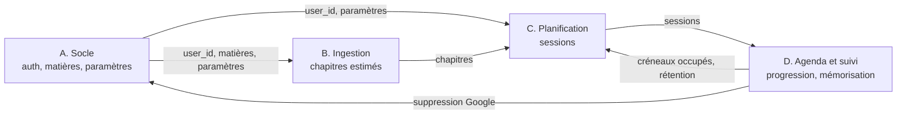

# Répartition des tâches

Proposition de découpage du travail entre les quatre membres de l'équipe, pour que chacun avance sans attendre les autres et que les pull requests se marchent le moins possible dessus. Elle s'appuie sur les priorités des [specs](../Spec.md), l'[architecture](../README.md#architecture), le [modèle de données](modele_donnees.md) et les [diagrammes de classes](diagramme_classes.md).

**C'est une proposition** : les lots ne sont pas encore attribués (§8).

---

## 1. Principe : des lots verticaux, pas des couches

Un découpage par couche (une personne sur Streamlit, une sur l'API, une sur le domaine, une sur la base) a l'air naturel : il colle au schéma d'architecture. Il fait pourtant attendre tout le monde.

| Découpage | Ce qui se passe |
|---|---|
| **Par couche** | Le frontend attend l'API, qui attend les services, qui attendent les repositories. Une fonctionnalité traverse quatre personnes avant de marcher. Chaque fonctionnalité oblige quatre personnes à se mettre d'accord |
| **Par lot vertical** | Chaque personne possède un domaine fonctionnel **de bout en bout** : son router, son service, son domaine, ses repositories, ses pages Streamlit et ses tests. Elle livre des fonctionnalités qui marchent, et ne dépend des autres que par quelques contrats fixés au départ |

MyPlan se découpe bien verticalement : l'ingestion, la planification et le suivi sont trois chaînes presque indépendantes, reliées par deux objets seulement (le chapitre, la session). Un quatrième lot porte le socle commun.

---

## 2. Les quatre lots

### Vue d'ensemble

| Lot | Domaine | Fonctionnalités | Pages Streamlit |
|---|---|---|---|
| **A. Socle et sécurité** | Comptes, matières, paramètres, base, sécurité transverse, tâches en arrière-plan | P0-01, P0-02, P0-08, P1-04, P1-07, P2-02, P2-07 | `app.py` (menu), `login.py`, `courses.py`, `settings.py` |
| **B. Ingestion** | Du fichier aux chapitres estimés | P0-03, P0-04, P0-05, P0-06, P0-07, P1-06, P2-03 | `documents.py` |
| **C. Planification** | Des disponibilités au planning | P0-09, P0-10, P0-11, P0-12, P1-08, P2-01, P2-06 | `availabilities.py`, `deadlines.py`, `plan.py` |
| **D. Agenda et suivi** | De la session faite au dashboard et à la mémorisation | P0-13, P1-01, P1-02, P1-03, P1-05, P2-04, P2-05 | `dashboard.py`, composant `session_card.py` |

Chaque lot a sept fonctionnalités. La charge n'est pas pour autant identique : le planificateur (C) et la synchronisation Google (D) sont les deux parties les plus difficiles, et c'est pourquoi le socle (A) prend en plus les tâches transverses.

### Lot A : socle et sécurité

| Phase | Livrables |
|---|---|
| 0 | Squelette du dépôt, `core/config.py`, `UtcDateTime`, écouteur SQLite (`foreign_keys`, `WAL`), `naming_convention`, première migration, CI (ruff, pytest, `alembic heads`), `frontend/api/base.py` |
| 1 (P0) | Inscription, connexion, JWT et refresh, argon2, `get_current_user`, rate limiting sur la connexion, CRUD des matières, paramètres d'étude avec valeurs par défaut, **tests d'isolation entre utilisateurs** pour tous les endpoints |
| 2 (P1) | Affichage dans le fuseau de l'étudiant sur toutes les pages et cohérence avec Google (P1-04 ; le stockage en UTC existe dès la phase 0), suppression de compte et export des données (P1-07, avec le lot D pour le nettoyage Google), en-têtes de sécurité, `pip-audit` en CI |
| 3 (P2) | APScheduler, `NotificationChannel` et `EmailChannel` (P2-02), préférences de notification (P2-07) |

Fichiers possédés : `backend/core/`, `backend/db/` (A écrit les modèles de la phase 0 ; ensuite, chaque lot fait évoluer ceux de ses tables), `backend/api/deps.py`, `backend/api/errors.py`, `backend/api/routers/auth.py`, `courses.py`, `settings.py`, `backend/integrations/notifications/`, `.github/`.

**A est aussi gardien des migrations** : il relit toute pull request qui en contient une (§5).

### Lot B : ingestion

| Phase | Livrables |
|---|---|
| 0 | Forme de `ParsedDocument` et de `DetectedChapter`, validée avec C ; jeu de fichiers d'exemple dans `tests/fixtures/documents/` (PDF avec et sans signets, Markdown imbriqué, PDF scanné, PDF vide, faux PDF) |
| 1 (P0) | `UploadValidator` (taille, *magic bytes*), `LocalFileStorage`, `PdfParser` et `MarkdownParser` avec limite de temps, `chapter_detection` (signets, puis heuristique), `estimation`, édition des chapitres : renommer, fusionner, scinder, supprimer |
| 2 (P1) | Extraction en arrière-plan avec statut `pending / processing / ready / failed` et code d'erreur (P1-06), rate limiting de l'upload |
| 3 (P2) | `LlmClient`, `AnthropicLlmClient`, `SummaryService`, validation de la sortie, protection contre l'injection de prompt (P2-03) |

Fichiers possédés : `backend/domain/chapter_detection.py`, `estimation.py`, `backend/services/ingestion_service.py`, `summary_service.py`, `backend/integrations/parsers/`, `llm/`, `storage/`, routers `documents.py` et `chapters.py`.

### Lot C : planification

| Phase | Livrables |
|---|---|
| 0 | Forme de `ChapterToPlan`, `FreeSlot`, `PlannedSession`, `PlanResult`, validée avec B et D |
| 1 (P0) | Disponibilités et exceptions, échéances et leurs chapitres, calcul des créneaux libres (heure locale vers UTC, changements d'heure testés), **`planner`** avec détection d'infaisabilité (« il manque X h avant le … »), `PlanningService`, vue liste et vue calendrier semaine et mois |
| 2 (P1) | Versions de planning, activation, comparaison de deux versions (P1-08), prise en compte des créneaux occupés via `BusyTimeReader` fourni par D |
| 3 (P2) | Replanification à partir de l'avancement réel, proposée puis validée (P2-01), insertion des révisions espacées quand `R` passe sous le seuil (P2-06, avec la fonction de rétention de D) |

Fichiers possédés : `backend/domain/planner.py`, `free_slots.py`, `replanning.py`, `backend/services/planning_service.py`, routers `availabilities.py`, `deadlines.py`, `plans.py`.

Le planificateur est la pièce la plus délicate du projet. C doit pouvoir s'y consacrer : c'est pourquoi les vues de suivi et de dashboard sont chez D, et non chez C.

### Lot D : agenda et suivi

| Phase | Livrables |
|---|---|
| 0 | Fabrique de sessions de test (`tests/fixtures/factories.py`), pour travailler sans attendre le planificateur |
| 1 (P0) | Marquer une session faite ou non faite (P0-13), composant `session_card.py` utilisé par la page Planning de C, endpoint de progression |
| 2 (P1) | OAuth Google, chiffrement Fernet du refresh token, `GoogleCalendarClient` (`CalendarWriter` puis `BusyTimeReader`), synchronisation idempotente (P1-01, P1-02, P1-05), dashboard : avancement par matière et par chapitre, heures prévues et réalisées, jours restants, sessions en retard (P1-03) |
| 3 (P2) | Auto-évaluation après session (P2-05), `memory` : stabilité, rétention, mise à jour après une révision (P2-04), affichage par chapitre |

Fichiers possédés : `backend/domain/memory.py`, `progress.py`, `backend/services/progress_service.py`, `calendar_sync_service.py`, `memory_service.py`, `backend/integrations/google/`, routers `study_sessions.py`, `progress.py`, `google.py`.

---

## 3. Phase 0 : ce qu'on fixe ensemble avant de se séparer

Les lots ne sont indépendants que si leurs frontières sont fixées **avant** que chacun écrive son code. Cette phase se fait à quatre, de préférence en une ou deux séances communes, et se termine par une seule pull request relue par tous.

| Contrat | Fichier | Rédigé par | Validé par |
|---|---|---|---|
| Modèles SQLAlchemy de toutes les tables P0, et première migration | `backend/db/models/` | A | tous |
| Énumérations | `backend/domain/enums.py` | A | tous |
| `ParsedDocument`, `DetectedChapter` | `backend/domain/documents.py` | B | C |
| `ChapterToPlan`, `FreeSlot`, `PlannedSession`, `PlanResult` | `backend/domain/planning.py` | C | B, D |
| Format des erreurs et codes connus | `backend/api/errors.py` | A | tous |
| Schémas Pydantic des endpoints P0 | `backend/api/schemas/` | chacun pour son lot | A |
| Client HTTP commun du frontend | `frontend/api/base.py` | A | tous |
| Fabriques de données de test | `tests/fixtures/factories.py` | D | tous |

La phase 0 tranche aussi les questions qui bloqueraient un lot plus tard :

| Question | Bloque | Où |
|---|---|---|
| Échéances sans chapitres, chapitres sans échéance | Le planificateur (C), dès la phase 1 | [modele_donnees.md](modele_donnees.md) §6.6 |
| Modifier un chapitre déjà étudié | L'édition des chapitres (B), dès la phase 1 | [modele_donnees.md](modele_donnees.md) §6.5 |
| Un compte ou plusieurs ; canal de notification ; LLM externe ou non | A et B | [Spec.md](../Spec.md) §9 |
| Reprise de `google_event_id` et agenda dédié | La synchronisation (D), en phase 2 : à trancher au plus tard en fin de phase 1 | [modele_donnees.md](modele_donnees.md) §6.1 et §6.4 |

La branche `develop`, où arrivent toutes les pull requests, n'existe pas encore : A la crée en phase 0 et protège `main` et `develop` sur GitHub.

Une fois cette pull request fusionnée, un changement de contrat se fait par une pull request dédiée, relue par les lots concernés : jamais au détour d'une fonctionnalité.

---

## 4. Dépendances entre lots, et comment ne pas les attendre

| Dépendance | Sans attendre |
|---|---|
| Tout le monde attend l'authentification de A | Phase 0 : un `get_current_user` provisoire qui renvoie l'utilisateur de test, remplacé par le vrai sans changer sa signature |
| C attend les chapitres de B | C construit ses `ChapterToPlan` à la main dans ses tests ; le planificateur ne lit jamais un PDF |
| D attend les sessions de C | D génère des sessions avec la fabrique de la phase 0 |
| C attend `BusyTimeReader` de D (P1-05) | C code contre l'interface avec un `FakeBusyTimeReader` ; le client Google se branche ensuite dans `container.py` |
| C attend la fonction de rétention de D (P2-06) | Signature fixée en début de phase 3 : `retention(state, at) -> float` |

La règle qui rend cela possible est déjà dans les diagrammes de classes : le domaine est pur et les intégrations sont derrière des interfaces. Chaque lot peut donc tester son code avec des faux, sans les autres.

---

## 5. Les fichiers partagés, premiers lieux de conflits

Quelques fichiers sont touchés par tous les lots. Ce sont eux qui créent les conflits de fusion, pas le code de chaque lot.

| Fichier | Risque | Règle |
|---|---|---|
| `backend/db/migrations/versions/` | Deux migrations créées en parallèle sur la même révision : Alembic se retrouve avec deux « têtes » et refuse de migrer | Une migration par pull request au plus. Avant la fusion, rebase sur `develop` puis `alembic heads` doit afficher une seule tête : la CI le vérifie. A relit toute migration |
| `backend/main.py` (inscription des routers) | Chaque lot y ajoute une ligne au même endroit | Une ligne par router, triée par ordre alphabétique : deux ajouts tombent rarement sur la même ligne |
| `backend/core/container.py` | Chaque lot y branche ses implémentations | Une section commentée par lot |
| `backend/domain/enums.py`, `backend/api/errors.py` | Ajouts concurrents | Ajouts en fin de section du lot, jamais de réorganisation sans prévenir |
| `requirements.txt` | Ajouts concurrents | Versions figées, une par ligne, ordre alphabétique |
| `frontend/api/` | Un seul `api_client.py` serait modifié dans presque chaque pull request | Un fichier par domaine (voir les [conventions](conventions_de_nommage.md) §3) |

Un fichier `.github/CODEOWNERS` désigne le lot responsable de chaque dossier, pour que GitHub demande automatiquement sa relecture.

---

## 6. Relectures croisées

Chaque pull request est relue par un autre membre. Les binômes de relecture suivent les **frontières** entre lots, là où une erreur coûte le plus :

| Le lot | est relu par | Parce que |
|---|---|---|
| B. Ingestion | A | L'upload est la principale surface d'attaque (fichiers piégés, path traversal, injection de prompt) : le lot sécurité la relit |
| C. Planification | B | B connaît les chapitres et leurs durées, que C consomme |
| D. Agenda et suivi | C | D lit les sessions que C produit, et la replanification de C dépend de la progression de D |
| A. Socle | D | D est le plus gros utilisateur des briques transverses (chiffrement, tâches en arrière-plan, suppression de compte) |

Les binômes tournent à chaque phase, pour que chacun ait lu le code de tous les lots à la fin du projet.

---

## 7. Calendrier par phase

Chaque phase se termine par une démonstration **de bout en bout**, faite sur `develop`, par une autre personne que celle qui a codé.

| Phase | A | B | C | D | Démonstration de fin de phase |
|---|---|---|---|---|---|
| **0. Contrats** | Squelette, CI, modèles, erreurs | `ParsedDocument`, fichiers d'exemple | Objets de planification | Fabriques de test | `pytest` et la CI passent sur un dépôt vide de fonctionnalités |
| **1. MVP (P0)** | Auth, matières, paramètres, isolation | Upload, extraction, chapitres, estimation | Disponibilités, échéances, planificateur, calendrier | Suivi des sessions | Un étudiant s'inscrit, envoie un PDF, corrige ses chapitres, saisit ses créneaux et un examen, obtient un planning ou le message « il manque X h », et marque une session faite |
| **2. v1 (P1)** | Fuseaux, RGPD, en-têtes | Extraction asynchrone | Versions de planning, conflits d'agenda | Google Agenda, dashboard | Le planning part dans Google Agenda ; le régénérer ne crée aucun doublon ; supprimer son compte supprime aussi les événements |
| **3. Valeur ajoutée (P2)** | Scheduler, emails, préférences | Résumés par LLM | Replanification, révisions espacées | Auto-évaluation, mémorisation | Un retard déclenche une proposition de replanification ; un rappel arrive par email ; une révision apparaît quand la rétention passe sous 70 % |

Les phases suivent l'ordre de développement des specs (§8) : le socle sécurisé d'abord, la mémorisation en dernier.

### Fin d'une tâche

Une pull request n'est fusionnée que si :

- les tests du lot passent, et les tests du domaine couvrent les cas limites (échéance déjà passée, aucun créneau, chapitre de zéro mot, changement d'heure) ;
- chaque nouvel endpoint qui prend un identifiant a son test d'isolation (`404` pour un autre utilisateur) ;
- les conventions de nommage sont respectées, ou le document est corrigé dans la même pull request ;
- la documentation touchée est à jour : modèle de données si une table change, diagramme de classes si une interface change.

### Avec un assistant de code

Les specs sont écrites pour être données à un assistant de code. Pour que quatre personnes et quatre assistants produisent un code cohérent :

- chaque demande à l'assistant inclut les [conventions de nommage](conventions_de_nommage.md) et les fichiers de contrat de la phase 0 ;
- l'assistant travaille dans le périmètre de fichiers du lot (§2) ; une modification hors périmètre se signale en pull request ;
- le code produit est relu comme un code humain : l'assistant ne connaît pas les décisions prises en séance tant qu'elles ne sont pas écrites dans `docs/`.

---

## 8. Attribution

À décider ensemble. Chaque lot demande un profil un peu différent :

| Lot | Profil le plus à l'aise |
|---|---|
| A. Socle et sécurité | Goût pour la configuration, l'authentification et la CI ; accepte de relire beaucoup de code des autres |
| B. Ingestion | Traitement de données et de texte, formats de fichiers, cas limites |
| C. Planification | Algorithmique, gestion des dates et des fuseaux, tests unitaires minutieux |
| D. Agenda et suivi | APIs externes, OAuth, visualisation de données |

| Membre | Lot |
|---|---|
| Abraham Miguel Tala | à attribuer |
| Marc Steven Mouthoud | à attribuer |
| Houria Debbioui | à attribuer |
| Aminata Yasmine Savane | à attribuer |
